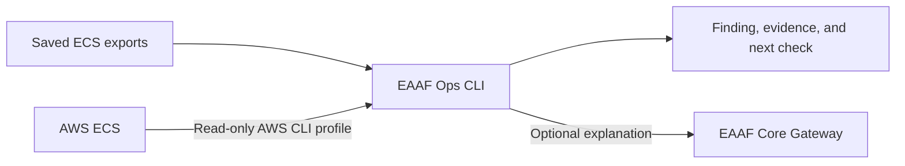

# EAAF AI for Ops

Replay an ECS incident from a captured event file. The CLI reports a probable cause, supporting event IDs and messages, and the next check. The first increment recognizes the image-not-found failure observed in the EAAF deployment demo. The example replaces the real infrastructure identifiers with fictional values.

## Architecture



The live collection path was verified against the ECS deployment demo. Saved examples cover the image pull and out-of-memory failures.

## Try it locally

From this repository with Python 3.14:

```powershell
python -m eaaf_ops examples/ecs-image-not-found.json
```

The expected finding is `container_image_not_found`, supported by `event-2`. An unsupported event set produces `insufficient_evidence`. Use a snapshot from one incident window. A captured failure does not establish the current service health.

## Diagnose AWS CLI exports

Run the offline example with an ECS service snapshot and a stopped task snapshot:

```powershell
python -m eaaf_ops examples/ecs-describe-services.json --tasks examples/ecs-describe-tasks.json
```

The sample produces `container_out_of_memory` from the stopped container's explicit reason. Exit code 137 by itself is insufficient. If the snapshots contain different recognized failure signals, the CLI returns them separately with their evidence and leaves the overall probable cause unset.

For your own capture, save the full JSON outputs from [`aws ecs describe-services`](https://docs.aws.amazon.com/cli/latest/reference/ecs/describe-services.html) and, optionally, [`aws ecs describe-tasks`](https://docs.aws.amazon.com/cli/latest/reference/ecs/describe-tasks.html). Use `--service NAME` if the first file contains several services. Include stopped tasks from the same service and cluster, and review the captured time window before drawing conclusions. You can run the diagnosis offline after collecting the files. Avoid sharing raw captures that contain account or network details.

## Collect from an AWS ECS service

Use AWS CLI v2 with an authenticated read-only profile. The identity needs `ecs:DescribeServices`, `ecs:ListTasks`, and `ecs:DescribeTasks` on the target resources.

```powershell
python -m eaaf_ops --aws-cluster eaaf-container-demo --service eaaf-container-demo --region eu-north-1 --profile YOUR_READ_ONLY_PROFILE
```

The CLI reads service events, lists up to 10 stopped tasks for the selected service, and requests their stop reasons. Collection is limited to the tasks ECS still returns. The same rules run on live evidence and saved exports. Run without `--model` to keep the diagnostic on your machine after collection. The CLI does not change AWS resources.

## Request an explanation through EAAF Core

Start [EAAF Core](https://github.com/tandrian06/eaaf) locally. Set `EAAF_OPS_API_KEY` in your shell to an application key from the Core configuration authorized for the requested alias. For this increment, the existing IT policy can be used locally with `eaaf-mock-it`. The CLI reads the environment variable and sends the request to the local Gateway. `EAAF_GATEWAY_URL` overrides the default `http://127.0.0.1:8000`.

```powershell
python -m eaaf_ops examples/ecs-image-not-found.json --model eaaf-mock-it
```

The mock verifies routing and returns a fixed message. The finding and its evidence come from the local rule. With an enabled and authorized real model, the optional completion explains the same report. Use sanitized inputs with external providers. Keep keys in local configuration outside Git.

The CLI reads local files or queries ECS through your AWS CLI session. It can optionally call the EAAF Gateway for an explanation. It has no remediation actions.
